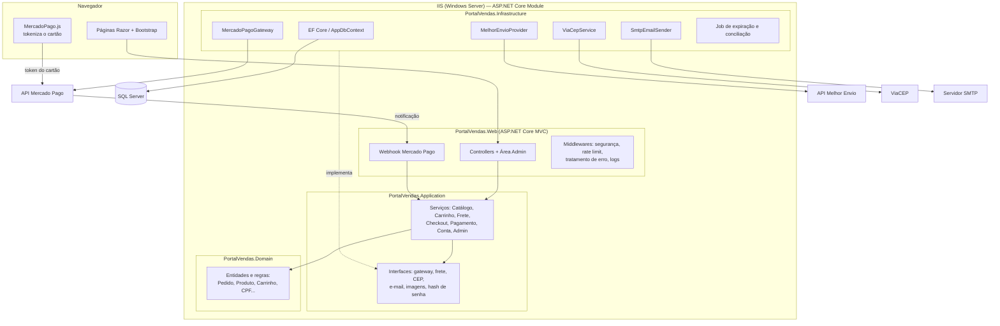

# 02 — Arquitetura

## 1. Estilo arquitetural

**Monólito modular em camadas** (Clean Architecture simplificada), publicado como um único site no IIS. Um time pequeno, um vendedor e ~100 usuários simultâneos não justificam microsserviços: o custo operacional (vários deploys, rede entre serviços, consistência distribuída) seria maior que o benefício. As camadas separam bem as responsabilidades para que partes possam ser extraídas no futuro, se for preciso. (ADR-001)



Regra de dependência: **Web → Application → Domain**; **Infrastructure → Application**. O domínio não conhece EF, HTTP nem Mercado Pago.

## 2. Stack

| Item | Escolha | Versão | Justificativa |
|---|---|---|---|
| Linguagem / runtime | C# / .NET | 10 (LTS) | LTS com suporte até nov/2028. O .NET 8 sai de suporte em nov/2026 (ADR-002) |
| Web | ASP.NET Core MVC + Razor | 10 | Escolha do usuário; renderização no servidor e bom SEO |
| Acesso a dados | Entity Framework Core (SQL Server) | 10.0 | Consultas parametrizadas por padrão, LINQ tipado |
| Esquema do banco | Scripts SQL versionados + `deploy-db.ps1` | — | O DBA controla o DDL, índices e collation; nada é criado sem revisão (ADR-003) |
| Banco | SQL Server | 2019 ou superior | Escolha do usuário; servidor próprio |
| Autenticação | Cookie Authentication + `PasswordHasher` (PBKDF2) + TOTP próprio para admin | nativo | Esquema de usuário sob controle do DBA, sem as tabelas do Identity (ADR-004) |
| Pagamentos | Mercado Pago — API v1/payments (Checkout Transparente) + Card Payment Brick | API REST | Pix, cartão e boleto numa só conta; cartão tokenizado no navegador (ADR-005) |
| Frete | Melhor Envio — `/api/v2/me/shipment/calculate` | API REST | Cota Correios, Jadlog e outras por peso e dimensões; contingência por faixa de CEP (ADR-006) |
| CEP | ViaCEP | API REST | Gratuito, sem chave |
| E-mail | SMTP (`System.Net.Mail`) | nativo | Funciona com qualquer provedor |
| Logs | Serilog (arquivo com rotação diária + console) | 9.0 | Logs estruturados com ID de correlação |
| Front-end | Bootstrap 5.3 via CDN com SRI + JavaScript puro | 5.3.3 | Responsivo, sem build de front-end |
| Testes | xUnit + EF Core SQLite em memória | 2.9 | Testa regras de negócio e transações reais sem servidor de banco |
| Hospedagem | IIS 10 + ASP.NET Core Hosting Bundle 10 | — | Servidor próprio (confirmado) |

## 3. Estrutura da solução

```
C:\SRC\PortalVendas
│  PortalVendas.sln
│  Directory.Build.props        ← versão do .NET e opções de compilação comuns
│  Directory.Packages.props     ← versões centralizadas dos pacotes NuGet
│  PROJETO.md  README.md
├─ docs\                        ← requisitos, arquitetura, banco, testes, implantação, ADRs
├─ db\
│  ├─ migrations\               ← V001__..., V002__... (DDL)
│  ├─ seed\                     ← dados de exemplo (só desenvolvimento/homologação)
│  └─ deploy-db.ps1             ← aplica os scripts pendentes e registra em SchemaVersao
├─ deploy\                      ← scripts de publicação no IIS e de backup
├─ src\
│  ├─ PortalVendas.Domain\      ← entidades, enums, regras (sem dependências)
│  ├─ PortalVendas.Application\ ← serviços de caso de uso, DTOs, interfaces
│  ├─ PortalVendas.Infrastructure\ ← EF Core, Mercado Pago, Melhor Envio, ViaCEP, SMTP, jobs
│  └─ PortalVendas.Web\         ← controllers, views, área Admin, Program.cs
└─ tests\
   └─ PortalVendas.Tests\       ← unitários e integração (SQLite)
```

## 4. Autenticação e autorização

| Perfil | Acesso | Regras |
|---|---|---|
| Anônimo | Vitrine, busca, produto, carrinho, cadastro, login | — |
| Cliente | + checkout, pagamento, meus pedidos, minha conta, endereços, LGPD | E-mail confirmado para finalizar compra |
| Administrador | Área `/admin` | Senha + código TOTP (Google Authenticator, Microsoft Authenticator) obrigatório |

- Cookie `HttpOnly`, `Secure`, `SameSite=Lax`, expiração deslizante de 2 horas (8 horas no "lembrar de mim" só para clientes).
- **Carimbo de segurança** (`CarimboSeguranca`) no cookie: trocar a senha ou anonimizar a conta invalida as sessões abertas. A validação ocorre a cada 5 minutos.
- Bloqueio após 5 falhas seguidas por 15 minutos (RF05).
- Tokens de confirmação de e-mail e de redefinição de senha: 32 bytes aleatórios, só o hash SHA-256 é gravado, uso único, validade de 24 h e 1 h.
- Autorização por política: `[Authorize(Policy = "Admin")]` exige o perfil Admin **e** a claim `amr=mfa`, emitida só depois do TOTP.
- **IDOR:** toda consulta de pedido, endereço ou pagamento do cliente filtra por `UsuarioId` do usuário logado; registro de outro cliente retorna 404, nunca 403 (não revela que existe).

## 5. Integrações externas

### 5.1 Mercado Pago (pagamentos)

| Operação | Chamada | Observações |
|---|---|---|
| Criar pagamento Pix | `POST /v1/payments` `payment_method_id=pix` | `date_of_expiration` = agora + 30 min; resposta traz `qr_code` e `qr_code_base64` |
| Criar boleto | `POST /v1/payments` `payment_method_id=bolbradesco` | Exige CPF e endereço do pagador; vencimento em 3 dias úteis |
| Criar pagamento com cartão | `POST /v1/payments` com `token`, `installments`, `payment_method_id`, `issuer_id` | O token vem do Card Payment Brick; o servidor usa o total do pedido, não o valor do navegador |
| Consultar pagamento | `GET /v1/payments/{id}` | Fonte da verdade para mudar status (RN08) |
| Estornar | `POST /v1/payments/{id}/refunds` | Cancelamento de pedido pago (RF16) |
| Webhook | `POST /webhooks/mercadopago?data.id=..&type=payment` | Assinatura `x-signature` validada com HMAC-SHA256 |

Toda criação de pagamento envia `X-Idempotency-Key` (GUID gravado no registro de pagamento) e `external_reference` = Id do pedido.

**Validação do webhook:** monta-se a string `id:{data.id};request-id:{x-request-id};ts:{ts};` (o `data.id` em minúsculas quando for alfanumérico), calcula-se HMAC-SHA256 com a chave secreta do webhook e compara-se, em tempo constante, com o `v1` do cabeçalho. Notificação inválida → 401 e log de alerta. Notificação válida → grava em `NotificacaoGateway` (deduplicada por `x-request-id`), consulta o pagamento na API e atualiza o pedido. A resposta ao Mercado Pago sai sempre em menos de 2 s; erros de processamento são reprocessados pelo job de conciliação.

### 5.2 Melhor Envio (frete)

- `POST https://melhorenvio.com.br/api/v2/me/shipment/calculate` (homologação: `https://sandbox.melhorenvio.com.br`).
- Cabeçalhos: `Authorization: Bearer {token}`, `Accept: application/json`, `User-Agent: PortalVendas ({e-mail de contato})` — o User-Agent é obrigatório.
- Corpo: CEP de origem e destino, lista de `products` com `width`, `height`, `length` (cm), `weight` (kg), `insurance_value` (preço unitário) e `quantity`. O Melhor Envio monta os volumes.
- Usa `custom_price` e `custom_delivery_time` (já com as taxas ou descontos configurados na conta). Opções com `error` são descartadas.
- Cotação em cache por 10 minutos (chave = CEP + itens + quantidades), para não recotar a cada clique.
- Timeout de 8 s. Em falha → tabela de contingência por faixa de CEP (`FaixaFrete`) e log de aviso.

### 5.3 ViaCEP

`GET https://viacep.com.br/ws/{cep}/json/`, chamado pelo servidor (endpoint `/api/cep/{cep}` com rate limit). Resultado em cache por 24 h. `{"erro": true}` → CEP não encontrado.

## 6. Fluxo de pedido e pagamento

```mermaid
sequenceDiagram
    actor Cliente
    participant Web
    participant Checkout as CheckoutService
    participant DB as SQL Server
    participant Pag as PagamentoService
    participant MP as Mercado Pago

    Cliente->>Web: Confirmar pedido (endereço, frete, chave de idempotência)
    Web->>Checkout: CriarPedido
    Checkout->>Checkout: Recota frete e recalcula total no servidor
    Checkout->>DB: BEGIN TRAN — UPDATE Produto SET EstoqueReservado += q<br/>WHERE disponível >= q (para cada item)
    Checkout->>DB: INSERT Pedido + Itens + Histórico — COMMIT
    Web-->>Cliente: Escolha a forma de pagamento
    Cliente->>Web: Pix / Boleto / Cartão (token)
    Web->>Pag: IniciarPagamento
    Pag->>MP: POST /v1/payments (X-Idempotency-Key)
    MP-->>Pag: id, status, QR Code / boleto
    Pag->>DB: INSERT Pagamento
    Web-->>Cliente: QR Code / boleto / resultado do cartão
    MP->>Web: Webhook payment.updated
    Web->>Pag: ProcessarNotificacao
    Pag->>MP: GET /v1/payments/{id}
    Pag->>DB: Pedido → Pago; Estoque -= q; Reservado -= q
    Cliente->>Web: (polling a cada 5 s) status do pedido
```

**Job em segundo plano** (`ExpiracaoPedidosJob`, a cada 5 minutos):
1. Pedidos "Aguardando pagamento" com `ExpiraEm` vencido: consulta o Mercado Pago antes de cancelar (o pagamento pode ter sido aprovado sem o webhook chegar); se não houver pagamento aprovado, cancela e libera a reserva.
2. Pagamentos "pendente" ou "em análise" há mais de 10 minutos: reconsulta no Mercado Pago (conciliação, caso um webhook se perca).

## 7. Tratamento de erros e observabilidade

- `UseExceptionHandler("/erro")` em produção: página amigável com o código de correlação (`TraceIdentifier`) para o suporte localizar no log. Nada de stack trace na tela.
- Erros de regra de negócio usam `Resultado`/`Resultado<T>` (sem exceção para fluxo esperado); `DomainException` apenas para violação de invariante.
- **Serilog:** `logs\portal-AAAAMMDD.log`, retenção de 30 dias, com `RequestId`, usuário (Id, nunca e-mail ou CPF) e tempo de resposta. CPF e telefone nunca vão para o log.
- Health check em `/health` (verifica o banco), para monitoramento externo.

## 8. Segurança desde o design (OWASP Top 10)

| Risco | Medida |
|---|---|
| A01 Controle de acesso | Políticas por perfil; filtro por `UsuarioId` em toda consulta do cliente; área admin com MFA |
| A02 Falhas criptográficas | HTTPS + HSTS; PBKDF2; tokens só com hash SHA-256; segredo TOTP e chaves do Data Protection protegidos com DPAPI no servidor |
| A03 Injeção | EF Core parametrizado; nenhum SQL concatenado; Razor codifica HTML por padrão; nada de `Html.Raw` com dado do usuário |
| A04 Design inseguro | Valores (total, frete, parcelas) sempre recalculados no servidor; estoque com reserva atômica; idempotência no checkout e nos pagamentos |
| A05 Configuração | Cabeçalhos: CSP, `X-Content-Type-Options`, `Referrer-Policy`, `X-Frame-Options`, `Permissions-Policy`; cabeçalho `Server` removido no IIS |
| A06 Componentes vulneráveis | Versões centralizadas; `dotnet list package --vulnerable` no pipeline |
| A07 Autenticação | Bloqueio por tentativas; rate limit no login; mensagens genéricas; MFA no admin; carimbo de segurança |
| A08 Integridade | Webhook com HMAC; SRI nos arquivos de CDN |
| A09 Logs | Login, falhas, mudanças de status e webhooks inválidos registrados |
| A10 SSRF | URLs externas fixas na configuração; nenhum endereço vindo do usuário é chamado pelo servidor |
| Uploads | Só JPG, PNG e WebP, verificados pela assinatura do arquivo (magic bytes), até 2 MB, nome gerado (GUID), gravados fora do site |
| CSRF | `AutoValidateAntiforgeryToken` global; webhook isento por ter assinatura própria |
| PCI | Cartão tokenizado no navegador pelo Mercado Pago; o servidor recebe só o token (SAQ A) |

**Rate limiting** (middleware nativo do ASP.NET Core), por IP: login e cadastro 10/min; CEP e frete 30/min; webhook 120/min.

## 9. Atendimento aos requisitos não funcionais

| RNF | Decisão que atende |
|---|---|
| RNF01 desempenho | Paginação no banco; índices de vitrine (ver 03-banco); `AsNoTracking` nas consultas de leitura; cache de frete e CEP; collation sem acento na busca |
| RNF02, RNF05, RNF06 | Seção 4 e 8 |
| RNF03 PCI | Card Payment Brick (ADR-005) |
| RNF04 segredos | `appsettings.Production.json` fora do repositório **ou** variáveis de ambiente no Application Pool do IIS; ver 06-implantacao |
| RNF07 LGPD | Exportação JSON e anonimização em Minha Conta; mascaramento de CPF e telefone nas telas do admin e nos logs |
| RNF08 auditoria | `PedidoHistorico` e `NotificacaoGateway` |
| RNF09 observabilidade | Seção 7 |
| RNF10 disponibilidade | Pool do IIS com `AlwaysRunning` + `preloadEnabled`; backup em 06-implantacao |
| RNF11/12 usabilidade e acessibilidade | Bootstrap responsivo, rótulos em todos os campos, foco visível, contraste AA |
| RNF13 testes | Regras no domínio e na aplicação, testadas sem UI |

## 10. Decisões registradas

| ADR | Decisão |
|---|---|
| [001](adr/001-monolito-modular.md) | Monólito modular em camadas |
| [002](adr/002-dotnet-10.md) | .NET 10 LTS |
| [003](adr/003-scripts-sql-versionados.md) | Esquema por scripts SQL versionados, não por migrations do EF |
| [004](adr/004-autenticacao-propria.md) | Autenticação por cookie com tabela própria e TOTP para admin |
| [005](adr/005-mercado-pago-checkout-transparente.md) | Mercado Pago, API de pagamentos + Card Payment Brick |
| [006](adr/006-frete-melhor-envio.md) | Frete pelo Melhor Envio com contingência por faixa de CEP |
| [007](adr/007-job-no-processo-iis.md) | Job em segundo plano dentro do processo do site |
