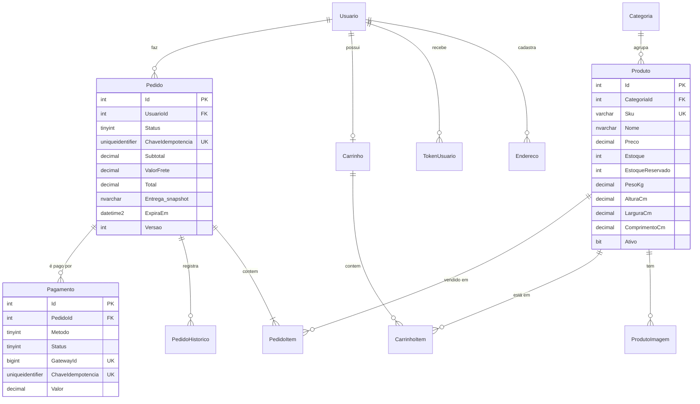

# 03 — Banco de Dados

## 1. Modelo conceitual



Tabelas independentes: `FaixaFrete` (contingência de frete), `Configuracao` (chave/valor editável no admin), `NotificacaoGateway` (log de webhooks) e `SchemaVersao` (controle de scripts).

## 2. Convenções

- Tabelas no singular, PascalCase, esquema `dbo`. PK `Id`; FK `<Tabela>Id`.
- Constraints nomeadas: `PK_`, `FK_`, `UQ_`, `CK_`, `DF_`, `IX_`.
- Datas em **UTC** (`datetime2(3)`); a aplicação converte para `America/Sao_Paulo` na exibição.
- Dinheiro em `decimal(12,2)`; nunca `float` nem `money`.
- Auditoria: `CriadoEm` e `AlteradoEm` em todas as tabelas de cadastro; `CriadoPor`/`AlteradoPor` no produto (alterado só por admin). Pedidos têm trilha completa em `PedidoHistorico`.
- Exclusão: produto com vendas é **desativado**, nunca excluído (RF17). Pedido nunca é excluído.

## 3. Modelo físico — destaques

O DDL completo está em [`db/migrations/V001__criacao_inicial.sql`](../db/migrations/V001__criacao_inicial.sql).

### Estoque (RN02, RN03)
`Produto.Estoque` é o físico; `Produto.EstoqueReservado` é o que está preso em pedidos aguardando pagamento. **Disponível = Estoque − EstoqueReservado.** A constraint `CK_Produto_EstoqueReservado` impede no próprio banco que se reserve mais do que existe, mesmo que a aplicação erre. A reserva é um único `UPDATE` atômico:

```sql
UPDATE dbo.Produto
   SET EstoqueReservado = EstoqueReservado + @qtd
 WHERE Id = @id AND Ativo = 1 AND Estoque - EstoqueReservado >= @qtd;
-- 0 linhas afetadas = sem estoque → a transação do pedido é desfeita
```

| Evento | Estoque | EstoqueReservado |
|---|---|---|
| Pedido criado | — | + qtd |
| Pagamento aprovado | − qtd | − qtd |
| Pedido expirado ou cancelado antes do pagamento | — | − qtd |
| Pedido pago cancelado antes do envio (com estorno) | + qtd | — |

### Pedido
- Endereço de entrega **copiado** para o pedido (`Entrega*`), porque o cliente pode editar ou excluir o endereço depois.
- `PedidoItem.PrecoUnitario` congela o preço da compra (RN01); `NomeProduto` e `Sku` também são copiados.
- `CK_Pedido_Total` garante `Total = Subtotal + ValorFrete − Desconto` no banco (RN05).
- `Versao` é token de concorrência otimista: webhook, job e admin podem tentar mudar o mesmo pedido ao mesmo tempo; quem perder a corrida recarrega e reavalia.
- `ChaveIdempotencia` (GUID gerado no formulário de checkout) com `UNIQUE` impede dois pedidos no duplo clique.

### Pagamento
- Um pedido pode ter várias tentativas de pagamento (cartão recusado → Pix). Só uma pode estar aprovada.
- `GatewayId` único (índice filtrado) evita gravar o mesmo pagamento do Mercado Pago duas vezes.
- Nenhum dado de cartão além de bandeira e 4 últimos dígitos.

## 4. Índices

| Índice | Consulta atendida |
|---|---|
| `IX_Produto_Vitrine (Ativo, CategoriaId, Preco) INCLUDE (...)` | Vitrine filtrada por categoria e faixa de preço, ordenada por preço; cobre a listagem sem ir à tabela |
| `IX_Produto_Ativo_CriadoEm (Ativo, CriadoEm DESC) INCLUDE (...)` | Vitrine padrão "mais recentes", sem categoria |
| `UQ_Produto_Slug`, `UQ_Produto_Sku` | Página do produto por slug; busca por SKU no admin |
| `IX_ProdutoImagem_ProdutoId (ProdutoId, Ordem)` | Fotos do produto em ordem |
| `UQ_Usuario_Email`, `UQ_Usuario_Cpf` (filtrado) | Login e unicidade de cadastro |
| `IX_Endereco_UsuarioId` | Endereços do cliente |
| `UQ_Carrinho_Token`, `UQ_Carrinho_UsuarioId` (filtrado) | Carrinho pelo cookie ou pela conta |
| `IX_Carrinho_AtualizadoEm` (filtrado, anônimos) | Limpeza de carrinhos abandonados |
| `IX_Pedido_UsuarioId_CriadoEm` | "Meus pedidos" |
| `IX_Pedido_Status_CriadoEm`, `IX_Pedido_CriadoEm` | Lista de pedidos do admin e painel de vendas |
| `IX_Pedido_Status_ExpiraEm` | Job de expiração (Status = 1 e ExpiraEm < agora) |
| `IX_PedidoItem_ProdutoId INCLUDE (Quantidade, Total)` | "Produto já teve venda?" e ranking de mais vendidos |
| `IX_Pagamento_Status_CriadoEm` | Job de conciliação |
| `UQ_NotificacaoGateway_RequestId` (filtrado) | Deduplicação de webhooks |

**Busca por texto:** `Nome` e `Descricao` usam a collation `Latin1_General_100_CI_AI`, então "cafe" encontra "Café". O `LIKE '%termo%'` não usa índice; com até 10 mil produtos ativos a varredura do índice coberto leva poucos milissegundos. Acima de ~100 mil produtos, a evolução é o **Full-Text Search** do SQL Server (script `V00X` futuro), sem mudar a interface.

## 5. LGPD — dados pessoais

| Coluna | Classificação | Tratamento |
|---|---|---|
| `Usuario.Nome`, `Email`, `Telefone`, `Cpf` | Pessoal | Mascarados no admin (`***.456.789-**`, `(19) *****-1234`); nunca em log |
| `Endereco.*`, `Pedido.Entrega*` | Pessoal | Visíveis só ao dono e ao admin |
| `Usuario.SenhaHash` | Credencial | Hash PBKDF2; nunca exibido |
| `Usuario.TotpSegredoProtegido` | Credencial | Cifrado pelo Data Protection (chave protegida por DPAPI) |
| `Pagamento.UltimosDigitos`, `Bandeira` | Pagamento | Permitido pelo PCI; número completo nunca é recebido |

**Exclusão a pedido do titular:** a conta é **anonimizada** (nome "Cliente removido", e-mail `removido-{id}@anonimo.invalid`, CPF e telefone nulos, senha invalidada, endereços apagados). Os pedidos ficam com o endereço de entrega, porque são documentos fiscais que precisam ser guardados por 5 anos; após esse prazo, um script de retenção (backlog) anonimiza também o endereço dos pedidos.

**Retenção:** carrinhos anônimos sem atividade há 30 dias e tokens expirados há 7 dias são apagados pelo job diário; `NotificacaoGateway` é mantida por 1 ano.

## 6. Scripts e migração

| Arquivo | Conteúdo |
|---|---|
| `db/migrations/V001__criacao_inicial.sql` | Todas as tabelas, constraints, índices e configurações iniciais |
| `db/seed/S001__dados_exemplo.sql` | Categorias, 12 produtos, faixas de frete de contingência — **só desenvolvimento e homologação** |
| `db/deploy-db.ps1` | Aplica os scripts pendentes em ordem, cada um numa transação, e registra em `dbo.SchemaVersao` |

```powershell
# Desenvolvimento: cria o banco, aplica o esquema e os dados de exemplo
.\db\deploy-db.ps1 -Servidor "localhost" -Banco "PortalVendas" -CriarBanco -ComSeed

# Ver o que está pendente sem aplicar
.\db\deploy-db.ps1 -Servidor "SRVSQL01" -Banco "PortalVendas" -SomenteListar
```

**Novas mudanças:** criar `V002__descricao.sql`, nunca editar um script já aplicado. **Reverter:** cada script novo de mudança destrutiva vem acompanhado de `rollback/R00N__descricao.sql`; para o V001 a reversão é restaurar o backup.

## 7. Usuário de banco da aplicação

A aplicação **não** usa `sa` nem `db_owner`. Ela só precisa de leitura e escrita:

```sql
-- No servidor (login do Windows da conta do Application Pool, ou login SQL)
CREATE LOGIN [IIS APPPOOL\PortalVendas] FROM WINDOWS;   -- se o SQL estiver na mesma máquina do IIS
-- ou: CREATE LOGIN portal_app WITH PASSWORD = '<senha forte>';

USE PortalVendas;
CREATE USER portal_app FOR LOGIN [IIS APPPOOL\PortalVendas];
ALTER ROLE db_datareader ADD MEMBER portal_app;
ALTER ROLE db_datawriter ADD MEMBER portal_app;
-- Sem permissão de DDL: o esquema muda só pelo deploy-db.ps1, com outro usuário
```

## 8. Backup

| Tipo | Frequência | Retenção |
|---|---|---|
| Completo | Diário, 02:00 | 30 dias |
| Diferencial | A cada 6 horas | 7 dias |
| Log de transações | A cada 15 minutos (modelo de recuperação FULL) | 7 dias |

Restore testado mensalmente em um banco `PortalVendas_RestoreTeste`. Scripts e passo a passo em `docs/06-implantacao.md`.
